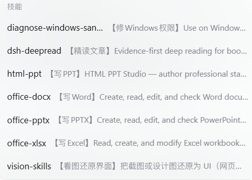

<div align="center">


# dsh-skill-labels

**Prepends a short Chinese caption to every skill in the DeepSeek Harness skill catalog.**

`html-ppt` → `【写PPT】HTML PPT Studio — author professional static HTML presentations …`

[](LICENSE)
[](https://github.com/topics/dsh-plugin)
[](#compatibility)

**English** | [简体中文](README.md)

</div>

---

## Overview

DeepSeek Harness exposes skills through two surfaces: the `available_skills` catalog the model sees during a session, and the `/` menu in the composer. By default both show the skill name plus its English description — names such as `office-xlsx` or `vision-skills`, followed by a full English sentence written for the model. Scanning that list by hand is slow.

This plugin prepends a 4–7 character Chinese caption to each skill description, so a skill reads as `【写Excel】Read, create, and modify Excel workbooks (.xlsx) …`. The original English description is preserved verbatim: its trigger wording is what the model uses to select a skill.



| | Skill | Description |
|---|---|---|
| Before | `html-ppt` | HTML PPT Studio — author professional static HTML presentations in many styles, layouts, and animations … |
| After | `html-ppt` | **【写PPT】** HTML PPT Studio — author professional static HTML presentations in many styles, layouts, and animations … |

## Features

- **Caption first** — a 4–7 character caption is placed before the description; the default template is `【caption】original description` and is configurable via `format`.
- **Both surfaces covered** — the model-facing catalog and the `/` menu read the same data, so both change together.
- **A living label table** — four override levels (built-in, bundled, user, row config); label files are re-read when their modification time changes, with no restart or reinstall.
- **The agent can label skills for you** — a bundled `skill_labels` tool lets the model list what is still unlabelled and write captions into your user table. No comparable plugin does this.
- **Not limited to Chinese** — a caption is just a prefix string: emoji, short English names, or numbering work too (`🎨 draw`, `excel`, `① daily`).
- **Zero dependencies, zero configuration** — no third-party packages, no peer dependencies, no build step, enabled by default once installed.
- **Source-agnostic** — captions match by **name**, not origin: bundled skills, workspace `.dsh/skills`, user-level `~/.dsh/skills`, or skills installed from GitHub all get captioned as long as the name is in a table; anything not listed stays untouched (one debug line in the host log).
- **Safe to remove** — uninstalling restores the wrapped registry methods and returns the catalog to its previous state.

## How it differs

Two comparable plugins existed before this one (as of 2026-10-11): [dsh-skill-source-label](https://github.com/lingyired/dsh-skill-source-label) marks where a skill comes from (project / personal / bundled), and [dsh-skill-manager-ytxue](https://github.com/YTxue/dsh-skill-manager-ytxue) is a skill management panel (enable/disable, batch import, spec checks). Both change *where skills come from* or *how they are managed*.

This plugin changes **what a skill is called at a glance**: a caption you control (four override levels, live file reload), applied to both the model-facing catalog and the `/` menu, and maintainable by the agent through `skill_labels`.

## Installation

**From GitHub (recommended):**

```bash
dsh plugin --profile web add github:Siloet-phy/dsh-skill-labels
```

Use `--profile desktop` for the Desktop application profile.

**From a local checkout (development):**

```bash
dsh plugin --profile web add file:/absolute/path/dsh-skill-labels
```

**Without installing (mount a local source directly):** append an `insert` row to the profile's `cordis.patch.yml`, with `name` pointing at the absolute URL of `index.js` (on Windows, use the `file:///C:/…` form):

```yaml
- insert:
    - id: skill-labels
      name: 'file:///C:/path/to/dsh-skill-labels/index.js'
      config: {}
```

> Keep exactly one of these in place — two active rows mount the plugin twice.
> Package installations require a restart of the affected DSH profile; the direct mount takes effect immediately.

## Configuration

The defaults work as-is. Labels are merged from four sources, **later overriding earlier**:

| Order | Source | Purpose |
|---:|---|---|
| 1 | built-in `DEFAULT_LABELS` | 12 captions for common skills |
| 2 | bundled `labels.json` | shared table shipped with the package |
| 3 | `~/.dsh/skill-labels.json` | your private table, **preserved across upgrades** |
| 4 | row config `config.labels` | written directly in `cordis.patch.yml` |

```json
{ "my-own-skill": "我的技能", "html-ppt": "做幻灯片" }
```

Row configuration:

| Field | Type | Default | Description |
|---|---|---|---|
| `format` | string | `【{label}】{description}` | Template; must contain `{description}` |
| `labels` | object | `{}` | Caption by skill name, highest priority |
| `labelsFile` | string \| false | `~/.dsh/skill-labels.json` | Path to the private table; `false` disables it |

Captions are just prefix strings, so emoji or short English names work too:

```json
{ "html-ppt": "🎨 draw", "office-xlsx": "excel", "my-own-skill": "① daily" }
```

## Let the agent fill in captions

Writing JSON by hand is tedious, so the plugin ships a **`skill_labels` tool** (available once DSH restarts, since tools are registered at plugin activation). Just ask in plain language:

> Find the skills that have no caption yet and label them all — keep each caption short, 4–7 characters, so the purpose is obvious at a glance.

The model then calls `skill_labels { action: "list" }` to get existing captions, their source (`builtin` / `package` / `user` / `config`) and the list of unlabelled skills (with descriptions), and `skill_labels { action: "set", labels: { … } }` to merge new captions into `~/.dsh/skill-labels.json`. The new captions apply on the next catalog read — no restart, no manual editing.

Writes are deliberately conservative: **merge, never replace**; **atomic** (temp file + rename); **one file only** (the label table); **a corrupt table refuses the write** instead of overwriting your data; invalid entries are skipped and reported.

## How it works

Every consumer of the skill catalog goes through one seam: `SkillRegistry.snapshot()` / `list()` from `@deepseek-ai/dsh-skill`.

| Surface | Call chain |
|---|---|
| Model skill catalog | `dsh-tool-skill` → `ctx.skills.snapshot()` → rendered as `` - `name`: description `` |
| `/` menu | `dsh-client-ui-skill` → Remote `skills/list` → `sessionSkillCatalog.list()` → `skillRegistry.list()` |

The plugin wraps those two methods on the registry **prototype** and rewrites each summary's `description` just before it is delivered.

- **Idempotent** — processed summaries are tracked in a `WeakSet`, so the nested `snapshot()` call inside `list()` does not double-prefix, and mounting the same file twice stays harmless.
- **Minimal surface** — only `description` is rewritten. Name, invocation policy, `path`, `source`, and `provider` are untouched, and skill body loading (`get()`) is unaffected.
- **Degrades safely** — if a future release renames the methods, the plugin logs a warning and the catalog stays as-is instead of breaking the session.
- **Reversible** — the wrappers are disposed with the plugin's `ctx.effect` cleanup.

### Design decisions

- **The English description is kept**: its trigger wording (`Use when the user asks for …`) is how the model selects skills; translating it would reduce hit rates, so the plugin only prefixes.
- **No machine translation**: automatic translation would make every catalog read depend on the network and a model call; captions are maintained by hand instead.
- **Not an official extension point**: the skill registry offers no description-decoration hook, which is why this plugin is deliberately tiny and version-tolerant.

## Compatibility

| Item | Requirement |
|---|---|
| DeepSeek Harness | Tested on `0.2.0-rc.2`; uses only `ctx.skills` and `ctx.logger`, expected to work from 0.1.x onward |
| Profile | `web` / `desktop` / `headless` — any profile mounting `@deepseek-ai/dsh-skill` and `dsh-tool-skill` |
| Platform | Windows / macOS / Linux; pure JavaScript, no native modules |
| Node.js | `>= 20` (the runtime bundled with DSH is sufficient) |
| Dependencies | None; no peer dependencies, no DSH imports |

## Security and privacy

- **Network**: no requests, no telemetry, no reporting.
- **Filesystem**: two optional JSON label tables are read; the only write happens when you or the model calls `skill_labels { action: "set" }`, and it touches that one file (temp file + rename).
- **Session and prompts**: no session events appended and no prompt injection; the catalog is rewritten at read time.
- **Tools**: exactly one tool (`skill_labels`) that only reads/writes the label table.

## Known limitations

1. Applies only to catalogs read **through the skill registry**; a plugin rendering skill lists on its own is unaffected.
2. Captions are hand-maintained; there is no automatic translation, and unregistered skills are left untouched.
3. Captions are matched by skill name, so two skills sharing a name share one caption.
4. The `/` menu catalog is cached per session by the client; refresh the page to see caption changes.

## Development

```bash
node selftest.mjs
```

The self-test covers: single-layer captions, `list → snapshot` without stacking, unregistered skills untouched, original summary objects not mutated, method restoration on unload, row-config override, live reload of the label file, corrupt label files ignored, and double mounting without stacking.

To contribute shared captions, edit `labels.json` (key: skill name, value: a 4–7 character Chinese caption) and open a pull request.

## Uninstall and upgrade

```bash
dsh plugin --profile web remove dsh-skill-labels
```

Uninstalling also removes the plugin row and restores the original methods. Upgrades are performed by removing and reinstalling; the private table at `~/.dsh/skill-labels.json` is not affected.

## License

[MIT](LICENSE) © 2026 Siloet-phy
